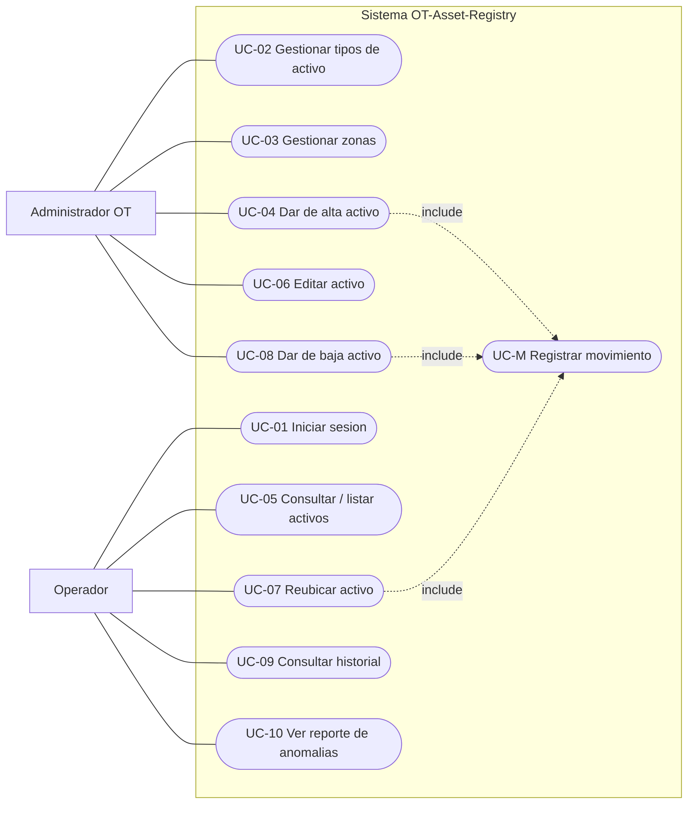
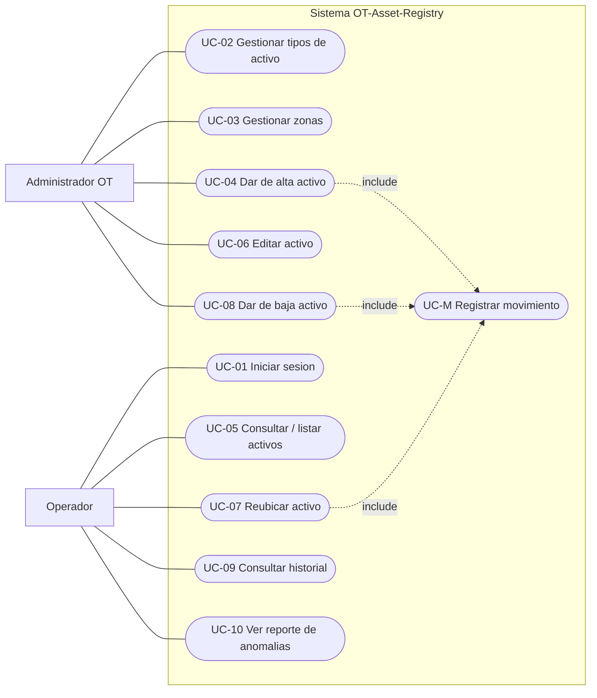

# 01 — Casos de uso

**Proyecto:** OT-Asset-Registry
**Materia:** Aplicaciones de Ingeniería de Software (Hybridge Education)
**Fase:** 3 — Diseño
**Autor:** Benjamín Martínez Pérez (`BENMP0902`)
**Fecha:** 2026-10-25

---

## Actores

Un **actor** es una entidad externa (persona o sistema) que interactúa con el
sistema para lograr una meta. No es "un usuario" genérico: es un *rol*.

| Actor | Descripción | Hereda de |
|---|---|---|
| **Administrador OT** | Ingeniero de seguridad / responsable del inventario. Control total. | Operador |
| **Operador** | Técnico de mantenimiento. Consulta y registra reubicaciones. | — |

> **Herencia de actor:** el Administrador *es un* Operador con permisos
> adicionales. Todo lo que el Operador puede hacer, el Administrador también.
> Esto evita duplicar asociaciones y refleja el modelo de privilegios.

## Diagrama de casos de uso

> El diagrama se muestra como PNG renderizado para garantizar su despliegue en
> GitHub. El código fuente Mermaid queda abajo (versionable y editable). El rigor
> formal del caso de uso vive en las especificaciones más abajo.

Código fuente del diagrama (Mermaid)

Las asociaciones del Administrador con UC-01/05/07/09/10 se heredan del Operador
(no se redibujan). El Administrador añade UC-02, 03, 04, 06 y 08.

## Relación «include»

UC-04 (alta), UC-07 (reubicación) y UC-08 (baja) **incluyen** UC-M (registrar
movimiento): las tres, para completar su meta, ejecutan obligatoriamente el paso
de crear un registro en el ledger. Eso es un «include» canónico —
comportamiento común y obligatorio extraído a un caso de uso propio—, no una
duplicación.

## Casos de uso que NO existen (error común)

No todo requerimiento funcional es un caso de uso. Un caso de uso lo **inicia un
actor** para lograr una meta observable. Por eso:

- **RF-10 (aplicar permisos por rol)** → no es caso de uso; es una
  responsabilidad transversal del sistema (lo verifica en cada UC).
- **RF-12 (derivar estado/ubicación del último movimiento)** → no es caso de
  uso; es comportamiento interno del sistema, ningún actor lo "pide"
  directamente.

Confundir comportamiento interno del sistema con casos de uso es un error
clásico: infla el diagrama con cosas que el usuario nunca inicia.

---

## Especificaciones de caso de uso

### UC-04 — Dar de alta un activo

| Campo | Contenido |
|---|---|
| **Actor principal** | Administrador OT |
| **Precondición** | El actor tiene sesión iniciada y rol Administrador. Existe al menos un `AssetType` y una `Zone`. |
| **Flujo principal** | 1. El actor solicita registrar un activo nuevo. 2. El sistema presenta el formulario (tipo, zona, identificador, datos descriptivos). 3. El actor envía los datos. 4. El sistema valida los campos. 5. El sistema crea el `Asset` y genera un movimiento `CHECK_IN` en el ledger (UC-M). 6. El sistema confirma el alta. |
| **Flujos alternativos** | 4a. Datos inválidos → el sistema muestra el error y regresa al paso 2. |
| **Postcondición** | Existe un `Asset` nuevo con un movimiento `CHECK_IN` asociado; su estado y ubicación quedan derivables del ledger. |
| **Reglas de seguridad** | Solo rol Administrador. Entrada validada y sanitizada (anti-inyección). La operación se registra con usuario + timestamp (trazabilidad). |

### UC-08 — Dar de baja un activo

| Campo | Contenido |
|---|---|
| **Actor principal** | Administrador OT (**exclusivo** — el Operador NO puede) |
| **Precondición** | Sesión iniciada con rol Administrador. El activo existe y no está ya dado de baja. |
| **Flujo principal** | 1. El actor selecciona un activo activo. 2. Solicita darlo de baja con un motivo. 3. El sistema valida el permiso de rol. 4. El sistema genera un movimiento `DECOMMISSION` (UC-M). 5. El estado del activo pasa a "dado de baja" (derivado). |
| **Flujos alternativos** | 3a. El actor no es Administrador → el sistema deniega y registra el intento. |
| **Postcondición** | El activo queda marcado como dado de baja vía su último movimiento; el ledger conserva todo su historial (no se borra nada). |
| **Reglas de seguridad** | Control de acceso estricto (OWASP A01 — Broken Access Control). La baja no elimina datos: es un movimiento más, append-only. |

## Trazabilidad caso de uso ↔ requerimiento

| Caso de uso | RF cubierto(s) |
|---|---|
| UC-01 Iniciar sesión | RF-09 |
| UC-02 Gestionar tipos de activo | RF-01 |
| UC-03 Gestionar zonas | RF-02 |
| UC-04 Dar de alta activo | RF-03 |
| UC-05 Consultar / listar activos | RF-04 |
| UC-06 Editar activo | RF-05 |
| UC-07 Reubicar activo | RF-06 |
| UC-08 Dar de baja activo | RF-07 |
| UC-09 Consultar historial | RF-08 |
| UC-10 Ver reporte de anomalías | RF-11 |
| UC-M Registrar movimiento | (soporte de RF-03, 06, 07) |
| — (sin UC) | RF-10, RF-12 → responsabilidades internas del sistema |
