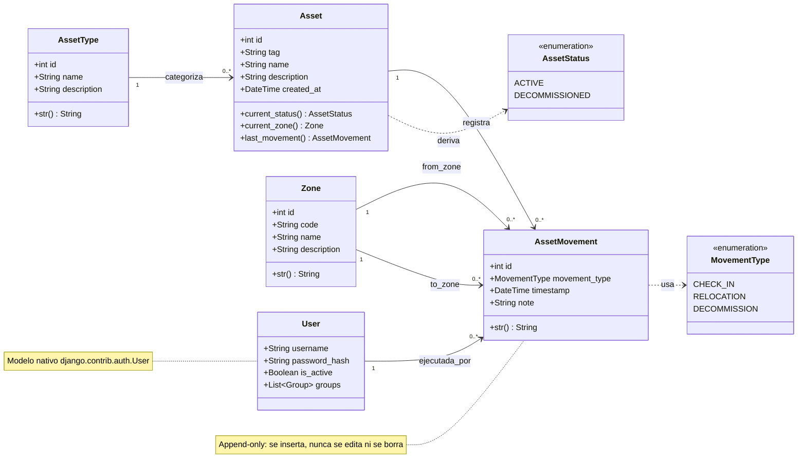

# 02 — Diagrama de clases

**Proyecto:** OT-Asset-Registry
**Materia:** Aplicaciones de Ingeniería de Software (Hybridge Education)
**Fase:** 3 — Diseño
**Autor:** Benjamín Martínez Pérez (`BENMP0902`)
**Fecha:** 2026-10-28

---

## Decisión de diseño: estado y ubicación son DERIVADOS

`Asset` no almacena su zona ni su estado actual. Ambos se **calculan** leyendo su
último `AssetMovement` (enfoque *event sourcing*). El ledger de movimientos es la
única fuente de verdad (*single source of truth*). Consecuencia en el modelo:
`current_zone()` y `current_status()` son **métodos**, no atributos.

> Alternativa desnormalizada (guardar `current_zone` en `Asset`) queda como
> *future work* de escalamiento; introduce riesgo de desincronización que no se
> justifica a la escala del MVP.

## Diagrama

> El diagrama se muestra como PNG renderizado para garantizar su despliegue en
> GitHub. El código fuente Mermaid queda abajo (versionable y editable).

Código fuente del diagrama (Mermaid)

## Notas por clase

### User
- **No se crea desde cero**: es el modelo `auth.User` nativo de Django. Reusar el
  sistema de autenticación probado del framework en lugar de escribir el propio
  es la práctica correcta (no reinventar criptografía ni gestión de sesión).
- Los **roles** (admin / operador) se implementan con `Group`/`Permission`
  nativos, no con un campo `role` manual.
- `password_hash`: Django almacena la contraseña con PBKDF2+salt, nunca en claro.

### AssetType
- Catálogo extensible por dato, no por código (Open/Closed Principle). Agregar un
  tipo nuevo de equipo no requiere tocar el código.

### Zone
- Ubicación física (línea de producción, tablero, cuarto de máquinas).
- `code`: identificador corto único (p. ej. `Z-A1`).

### Asset
- Entidad central. Guarda solo datos **descriptivos e inmutables** (tag, nombre,
  tipo, alta).
- `current_status()`, `current_zone()`, `last_movement()`: **métodos derivados**
  del ledger. No son columnas en la base de datos.

### AssetMovement (ledger)
- **Append-only**: se inserta, nunca se edita ni se borra. No expone métodos
  `update()` ni `delete()`.
- `from_zone` es nulo en `CHECK_IN` (el activo no venía de ninguna zona).
- `to_zone` es nulo en `DECOMMISSION` (el activo sale de operación).
- `timestamp` + `ejecutada_por` (User) = trazabilidad completa (quién/qué/cuándo).

## Mapeo a modelos de Django (preview Semana 2)

| Clase | Será en Django |
|---|---|
| `AssetType`, `Zone`, `Asset`, `AssetMovement` | `class X(models.Model)` |
| `MovementType`, `AssetStatus` | `models.TextChoices` |
| Relación `1 --> 0..*` | `ForeignKey(..., on_delete=PROTECT)` |
| `User`, roles | `django.contrib.auth` + `Group` |

## Lectura de seguridad

- **Integridad por diseño:** el ledger sin `update`/`delete` hace el historial
  inmutable → *audit trail* confiable (CIS Control 8).
- **No repudio:** cada movimiento guarda `ejecutada_por` → ninguna acción es
  anónima.
- **`on_delete=PROTECT`:** impide borrar un `AssetType` o `Zone` que aún tiene
  activos/movimientos asociados → previene registros huérfanos y pérdida de
  trazabilidad.
- **Borrado lógico, no físico:** dar de baja un activo es un movimiento
  `DECOMMISSION`, no un `DELETE`. Los datos nunca se destruyen.
