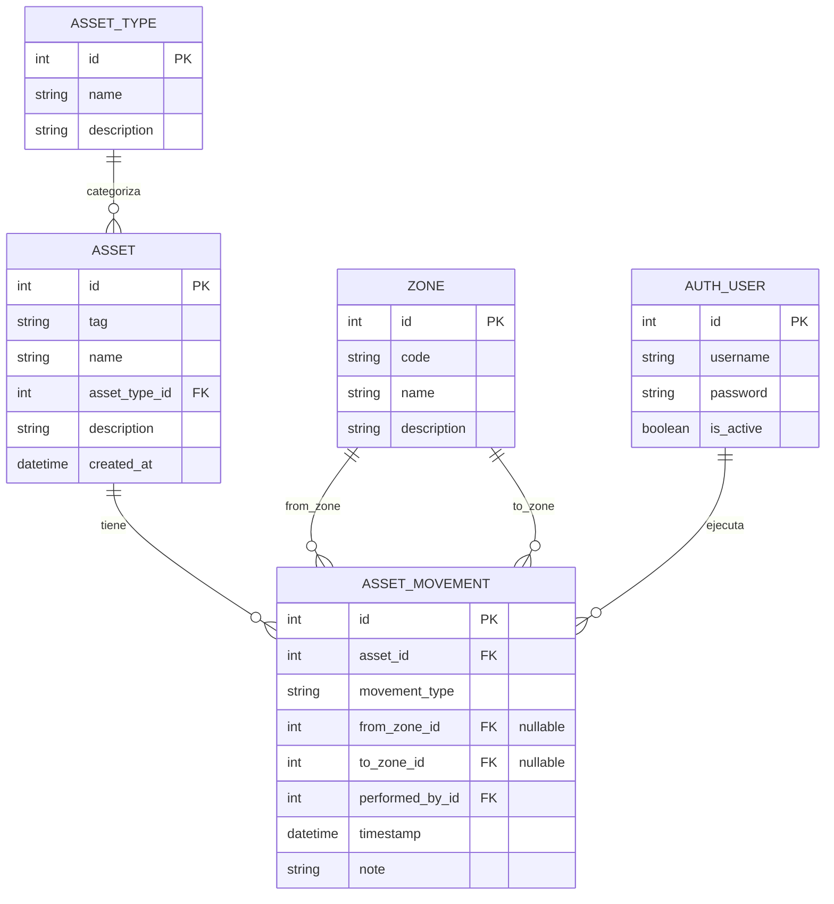

# 03 — Modelo entidad-relación (ERD)

**Proyecto:** OT-Asset-Registry
**Materia:** Aplicaciones de Ingeniería de Software (Hybridge Education)
**Fase:** 3 — Diseño
**Autor:** Benjamín Martínez Pérez (`BENMP0902`)
**Fecha:** 2026-10-28

---

## Del diagrama de clases al modelo de datos

El diagrama de clases describía objetos (atributos + métodos). El ERD describe
**tablas**: solo datos persistentes, llaves primarias (PK), llaves foráneas (FK)
y cardinalidad. Los *métodos* (`current_zone()`, etc.) no aparecen: no se guardan,
se calculan. Esa es la traducción conceptual entre las dos vistas.

## Diagrama

> El diagrama se muestra como PNG renderizado para garantizar su despliegue en
> GitHub. El código fuente Mermaid queda abajo (versionable y editable).

Código fuente del diagrama (Mermaid)

## Decisiones de modelado

- **`ASSET` no tiene columna `zone_id` ni `status`.** La ubicación y el estado
  actuales se derivan del último `ASSET_MOVEMENT` (coherente con el diagrama de
  clases). La zona vive en los movimientos, no en el activo.
- **`ASSET_MOVEMENT` tiene dos FK a `ZONE`** (`from_zone_id`, `to_zone_id`),
  ambas **nullable**: `CHECK_IN` no tiene origen; `DECOMMISSION` no tiene destino.
- **`AUTH_USER`** es la tabla del sistema de autenticación de Django
  (`auth_user`), no una tabla propia. `performed_by_id` la referencia para la
  trazabilidad.
- **`movement_type`** se modela como `string` con valores controlados
  (`CHECK_IN`, `RELOCATION`, `DECOMMISSION`) vía `TextChoices` de Django, no como
  tabla catálogo: es un conjunto cerrado y pequeño que no cambia por dato.

## Normalización

El modelo está en **3FN (tercera forma normal)**: no hay grupos repetidos (1FN),
cada tabla tiene una PK única y los atributos dependen de ella por completo (2FN),
y no hay dependencias transitivas (3FN) — por ejemplo, el nombre del tipo de
activo vive solo en `ASSET_TYPE`, no duplicado en cada `ASSET`.

## Seguridad e integridad

- **FK con `ON DELETE PROTECT`** (en Django `on_delete=PROTECT`): no se puede
  borrar un `ASSET_TYPE` o `ZONE` referenciado → evita registros huérfanos y
  pérdida de trazabilidad.
- **`ASSET_MOVEMENT` es append-only**: a nivel de aplicación no se exponen
  `UPDATE` ni `DELETE` sobre esta tabla → pista de auditoría inmutable.
- **`performed_by_id` obligatorio**: ninguna operación queda sin autor (no repudio).
