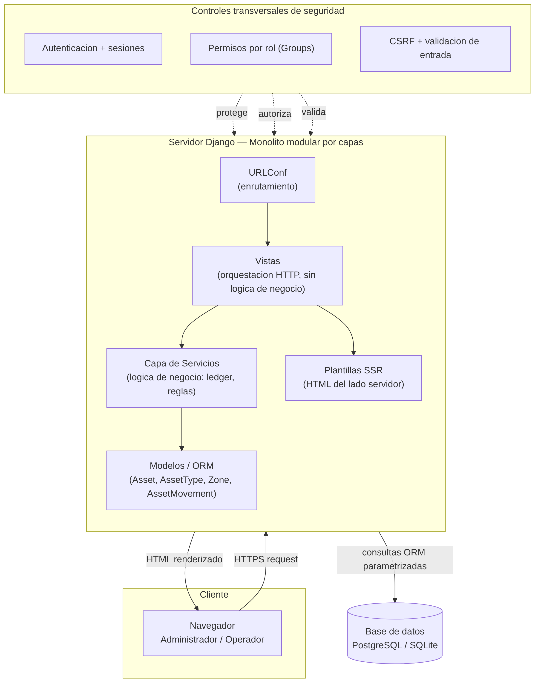
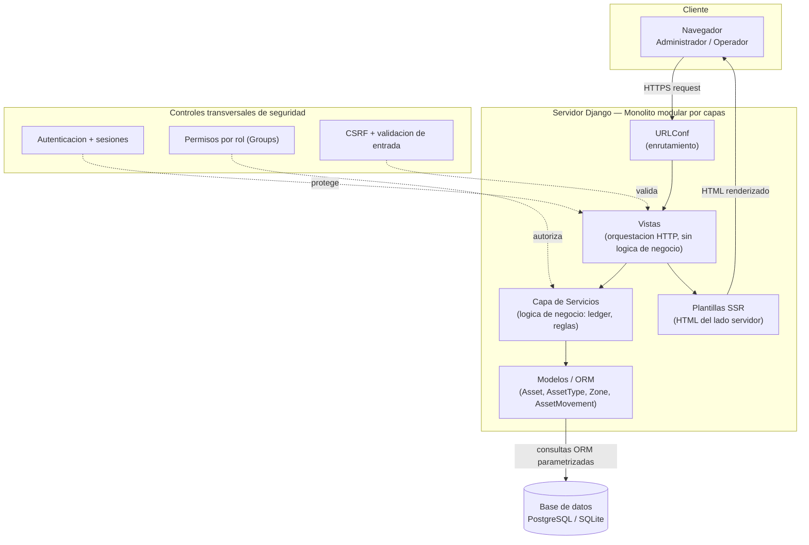

# 04 — Arquitectura del sistema

**Proyecto:** OT-Asset-Registry
**Materia:** Aplicaciones de Ingeniería de Software (Hybridge Education)
**Fase:** 3 — Diseño
**Autor:** Benjamín Martínez Pérez (`BENMP0902`)
**Fecha:** 2026-10-28

---

## Estilo arquitectónico

**Monolito modular por capas** (*layered modular monolith*). Una sola aplicación
desplegable, organizada internamente en capas con responsabilidad única, donde
cada capa solo se comunica con la adyacente. Es el patrón que Django favorece y
el adecuado para el alcance del MVP: toda la complejidad de microservicios
(red, despliegue, observabilidad distribuida) sería sobre-ingeniería aquí.

## Diagrama

> El diagrama se muestra como PNG renderizado para garantizar su despliegue en
> GitHub. El código fuente Mermaid queda abajo (versionable y editable).

Código fuente del diagrama (Mermaid)

## Responsabilidad de cada capa

| Capa | Responsabilidad | Qué NO hace |
|---|---|---|
| **URLConf** | Mapear URL → vista | Nada de lógica |
| **Vistas** | Recibir request, llamar al servicio, devolver response | **No** contiene reglas de negocio |
| **Servicios** | Lógica de negocio: crear movimientos, aplicar reglas, verificar permisos | No habla HTTP ni SQL directo |
| **Modelos / ORM** | Definir entidades y persistir | No contiene flujo de aplicación |
| **Plantillas** | Renderizar HTML (SSR) | No consulta datos |

> **Regla de oro — por qué existe la capa de servicios:** si la lógica del ledger
> viviera en las vistas (*fat views*), sería imposible de probar sin simular una
> petición HTTP, imposible de reutilizar, y la seguridad quedaría dispersa.
> Extraerla a servicios la hace testeable en aislamiento y concentra las reglas
> en un solo lugar. Es el patrón **Service Layer**.

## Controles de seguridad por capa (defensa en profundidad)

La seguridad no es una capa, es **transversal** (*cross-cutting concern*) — actúa
en varias capas a la vez. Esto es *defense in depth*:

| Control | Capa donde actúa | Mitiga |
|---|---|---|
| Autenticación + sesiones | Vistas (middleware) | Acceso no autenticado |
| Permisos por rol (Groups) | Servicios | OWASP A01 — Broken Access Control |
| CSRF + validación de entrada | Vistas (middleware/forms) | CSRF, inyección |
| ORM parametrizado | Modelos → BD | OWASP A03 — SQL Injection (CWE-89) |
| Hash PBKDF2+salt | Sistema de auth | Robo de credenciales (CWE-916) |

> **Por qué la autorización vive en la capa de servicios y no solo en la UI:**
> ocultar un botón en la plantilla **no es seguridad** — un atacante llama al
> endpoint directo. El permiso debe verificarse donde ocurre la acción (el
> servicio), no donde se muestra. Validar solo en el cliente/UI es el error que
> produce la vulnerabilidad #1 del OWASP Top 10.

## Despliegue (contexto)

- **Desarrollo:** servidor de desarrollo de Django + SQLite, en WSL2.
- **Target:** Django (vía WSGI/ASGI) + PostgreSQL. `DEBUG=False`, `SECRET_KEY` y
  credenciales desde variables de entorno (nunca en el código).
